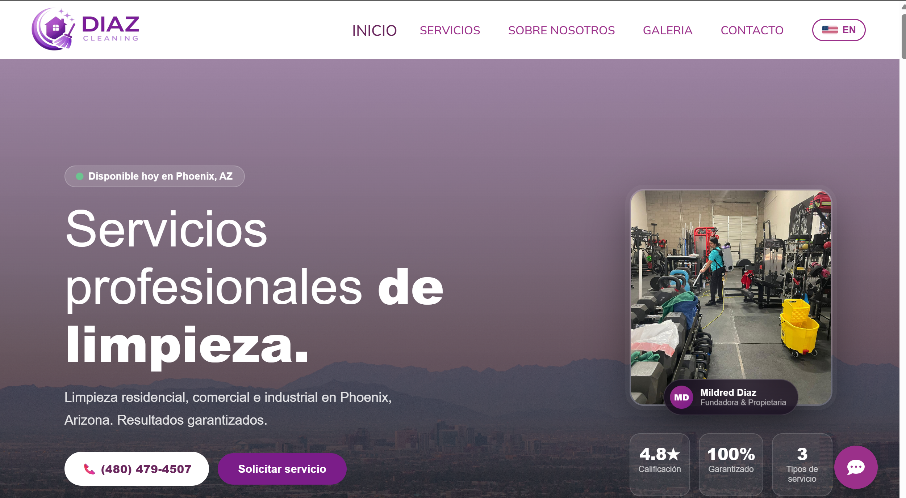

# Diaz Cleaning — Sitio web

Sitio web de **Diaz Cleaning LLC**, empresa de servicios de limpieza residencial y comercial en Phoenix y Glendale, Arizona, Estados Unidos.

**Sitio en vivo:** [diazcleaning-az.com](https://diazcleaning-az.com)



## Sobre el proyecto

Proyecto desarrollado por encargo para un cliente real. El objetivo era dar presencia en línea a un negocio nuevo, mostrar sus servicios con fotos de trabajos realizados y facilitar que los clientes soliciten una cotización.

## Funcionalidades

- **Bilingüe (español / inglés)** con selector de idioma en el encabezado.
- **Catálogo de servicios** organizado en limpieza residencial, comercial y especializada.
- **Galería de trabajos filtrable** por categoría (residencial, comercial, oficinas, industrial), con fotos de antes y después.
- **Formulario de contacto** para solicitar cotizaciones.
- Accesos rápidos de contacto: llamada, WhatsApp, correo, SMS y redes sociales.
- **Mapa integrado** con la ubicación del negocio y horarios de atención.
- Sección de preguntas frecuentes.
- Diseño adaptable a celular, tableta y escritorio.

## Tecnologías

- [Astro](https://astro.build)
- React
- TypeScript
- HTML y CSS

## Ejecutar en local

```bash
npm install
npm run dev
```

El sitio queda disponible en `http://localhost:4321`.

## Autor

**Ángel David Díaz Villanueva**
Desarrollador Web y Móvil
[GitHub](https://github.com/david220506h) · diazdavid2435@gmail.com
